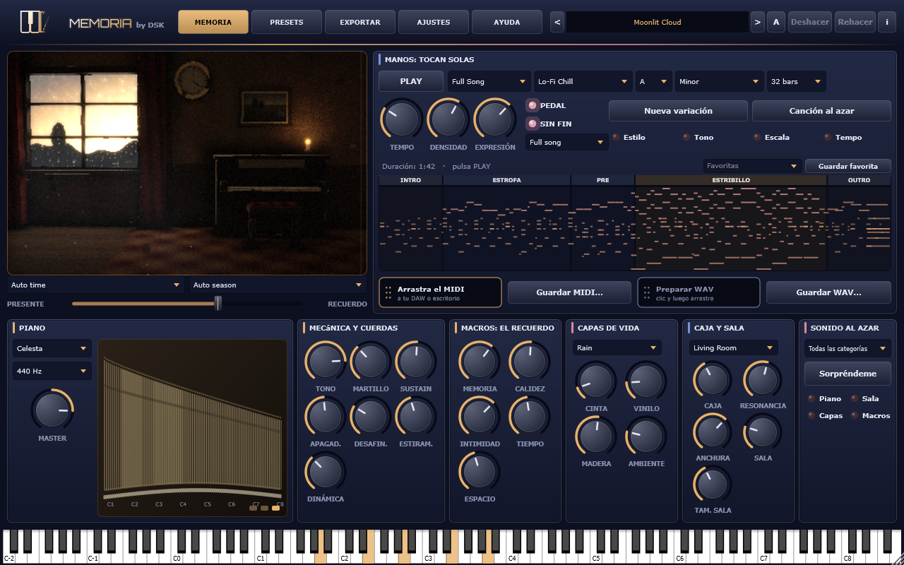

# Memoria by DSK

**Un piano con alma: un piano modelado físicamente envuelto en capas de recuerdo.**

Instrumento gratuito VST3 / AU / Standalone de [DSK Music](https://www.dskmusic.com/memoria/) para lo-fi y chill beats, piano emocional,
bandas sonoras, estudiar y relajarse.

**[Descargar](#descarga)** · [Página del producto](https://www.dskmusic.com/memoria/) · [Última versión](https://github.com/dskmusic/memoria-by-dsk/releases/latest)

[](https://github.com/dskmusic/memoria-by-dsk/actions/workflows/build.yml)
[](https://github.com/dskmusic/memoria-by-dsk/releases/latest)
[](https://github.com/dskmusic/memoria-by-dsk/releases)


Sin muestras: cada cuerda, cada martillo y la caja de resonancia se calculan en tiempo real, así que el piano respira con tu forma de tocar.
Encima viven las cosas que convierten un piano en un *recuerdo*: la habitación, la cinta desgastada, el polvo del vinilo, la madera que cruje,
la lluvia en la ventana. Un solo deslizador, **Memoria**, te lleva de un piano de estudio nítido y presente a una cinta encontrada en un desván.



## Características

- **Piano modelado físicamente (sin librería de muestras):** cada parcial es un resonador con decaimiento e inharmonicidad real de cuerda,
  2-3 cuerdas desafinadas por nota (batidos), el doble decaimiento del piano, fieltro del martillo que brilla más con la velocidad,
  posición de golpe, apagadores, modos de la caja y resonancia simpática. El pedal de sustain (CC64) es continuo: el medio pedal funciona.
- **Once instrumentos:** cola de concierto, vertical, piano de fieltro, honky-tonk, piano de juguete, celesta, piano eléctrico (estilo Rhodes, con trémolo y chorus), vibráfono (con su motor), glockenspiel, caja de música y marimba.
- **Macro Memoria** más Calidez, Intimidad (micro cerca o lejos), Tiempo (cuánto ha envejecido el piano) y Espacio.
- **Capas de vida:** sonidos de madera (banco, mecanismo, pedal, apagadores), cinta (wow y flutter, saturación, pérdida de agudos, ruido, dropouts),
  vinilo (crackle, rumble, pop de la aguja) y un mundo lejano: lluvia, viento, chimenea, pájaros al amanecer. Cinco salas: salón, iglesia, estudio, cabaña de madera y sala de conciertos vacía.
- **Manos: un compositor generativo para quien no toca.** Escribe canciones enteras - intro, estrofas, estribillos, puente y final - con armonía funcional
  (séptimas, novenas, acordes sus, dominantes, cadencias), motivos que se desarrollan, estribillos con gancho, patrones de acompañamiento y una interpretación expresiva
  (dinámica, acordes arpegiados, rubato, pedal). Catorce estilos (Bossa Nova, Cantautor, Tango lento, tema de Pueblo, Lo-Fi Chill, Cinematic, Romantic, Minimal, vals de cuna, Power Ballad, Classical: el Canon en Re de Pachelbel con variaciones crecientes, Jazz Ballad, Lo-Fi Loop y un Nocturno al estilo de Chopin), 8 escalas, cualquier tono,
  de 16 a 128 compases, con su propio reloj y botón PLAY (nunca siguen el transporte del DAW); arrastra el MIDI a tu DAW para usarlo allí. **Nueva variación** y **Canción al azar** (con bloqueos) crean otra con un clic. Pulsa en cualquier punto del mapa de la canción para saltar ahí mientras suena.
  **Exporta la canción:** arrástrala como archivo MIDI (o como WAV renderizado) directamente a tu DAW, o guárdala como .mid / .wav.
- **232 presets de fábrica** en 10 categorías: Lo-Fi, Felt, Cinematic, Rainy, Vintage, Church, Lullaby, Study, Concert y Toy.
  **Sonido al azar** genera un piano + sala + capas + macros nuevos en cualquier categoría, con bloqueos por sección, validado y con el nivel igualado.
- **Una habitación 3D cinematográfica, renderizada en directo en tu tarjeta gráfica:** una escena 3D real (raymarching, sombras suaves, oclusión ambiental, reflejos en el lacado y el suelo,
  rayos de luz volumétricos con polvo, lluvia en el cristal, una vela que parpadea, envejecimiento de película). Las teclas del piano se hunden con las notas que suenan.
  Sigue el ambiente que elijas (lluvia, viento, chimenea, amanecer) y envejece con Memoria (sepia, grano, rayas, destellos).
  Elige la **hora del día** (del amanecer a la noche) y la **estación** tras la ventana (flores, hojas, nieve); un **reloj de pared** sigue la luz, una **fotografía** desenfocada cambia con cada preset y las cortinas y la vela reaccionan a la música, más en los estribillos.
  Tres niveles de calidad en Ajustes; si tu tarjeta no puede, usa una escena por CPU.
- **El interior del piano, en vivo:** 88 cuerdas que brillan y vibran, martillos que golpean con la velocidad real, apagadores y pedal.
- **Exportación de audio largo:** las manos tocan de 1 minuto a 3 horas en WAV, FLAC u OGG.
- Cambios de preset sin clics, A/B, deshacer/rehacer, MIDI learn, navegador de presets con etiquetas y favoritos, interfaz redimensionable, **English / Español**
  (automático o manual) y página de Ayuda integrada.
- Determinista: la exportación desde el DAW es idéntica a lo que oíste, con cualquier tamaño de bloque.

## Descarga

**Página del producto:** https://www.dskmusic.com/memoria/

| Sistema | Recomendado | Otros formatos |
|---|---|---|
| **Windows** 10/11 (64 bits) | [Instalador (.exe)](https://github.com/dskmusic/memoria-by-dsk/releases/latest/download/Memoria-by-DSK-win-x64-setup.exe) | [VST3 (zip)](https://github.com/dskmusic/memoria-by-dsk/releases/latest/download/Memoria-by-DSK-win-x64-vst3.zip) · [Standalone (zip)](https://github.com/dskmusic/memoria-by-dsk/releases/latest/download/Memoria-by-DSK-win-x64-standalone.zip) |
| **macOS** 11+ (Universal: Apple Silicon + Intel) | [Instalador (.pkg)](https://github.com/dskmusic/memoria-by-dsk/releases/latest/download/Memoria-by-DSK-macos-universal-installer.pkg) | [VST3](https://github.com/dskmusic/memoria-by-dsk/releases/latest/download/Memoria-by-DSK-macos-universal-vst3.zip) · [AU](https://github.com/dskmusic/memoria-by-dsk/releases/latest/download/Memoria-by-DSK-macos-universal-au.zip) · [Standalone](https://github.com/dskmusic/memoria-by-dsk/releases/latest/download/Memoria-by-DSK-macos-universal-standalone.zip) |
| **Linux** x86_64 | [VST3 (tar.gz)](https://github.com/dskmusic/memoria-by-dsk/releases/latest/download/Memoria-by-DSK-linux-x64-vst3.tar.gz) | [Standalone (tar.gz)](https://github.com/dskmusic/memoria-by-dsk/releases/latest/download/Memoria-by-DSK-linux-x64-standalone.tar.gz) |

Todos los archivos y notas: [última versión](https://github.com/dskmusic/memoria-by-dsk/releases/latest) · sumas de verificación: [SHA256SUMS.txt](https://github.com/dskmusic/memoria-by-dsk/releases/latest/download/SHA256SUMS.txt)

Los binarios no están firmados. **Windows:** puede aparecer SmartScreen, pulsa *Más información* → *Ejecutar de todos modos*.
**macOS:** si el instalador "no se puede abrir" o "está dañado", clic derecho → *Abrir*, o ejecuta `xattr -dr com.apple.quarantine <archivo>` en Terminal.

### Instalación

- **Instalador de Windows:** instala el VST3 en `C:\Program Files\Common Files\VST3` y la app Standalone.
  **Instalador de macOS:** instala VST3, AU y la app Standalone. Reescanea plugins en tu DAW (Logic: AU Manager).
- **Manual:** copia `Memoria by DSK.vst3` a tu carpeta VST3 (`~/.vst3` en Linux).

### Primeros pasos

1. Carga **Memoria** como instrumento y tócalo con un teclado MIDI (pedal incluido), o pulsa **PLAY** en el panel de Manos para que toque el pianista generativo.
2. Elige un preset (pestaña PRESETS) o pulsa **Sorpréndeme**, y desliza **Memoria** de *presente* a *recuerdo*.
3. Moldea el piano (Tone, Hammer, Sustain, Dampers, Detune...) y la sala, o pulsa **Sorpréndeme**.

Los presets y ajustes se guardan en `Documents/DSK Music/Memoria/`.

## Compilar desde el código

Requisitos: CMake 3.22+, compilador C++20 (Visual Studio 2022, Xcode 15 o GCC 11+), Ninja. JUCE 8 se descarga solo.

```bash
./build_local.sh Release            # macOS / Linux
build_local.bat Release             # Windows
```

La herramienta de línea de comandos `MemoriaTool` (se compila a la vez) ejecuta los tests (`test`), genera el banco de fábrica (`factory`),
renderiza material de escucha (`piano`, `hands`) y las capturas, el vídeo demo y el tráiler (`screenshot`, `video`, `trailer`).

## Licencia

GPLv3 - ver [LICENSE](LICENSE) y [licenses/](licenses/). Construido con [JUCE](https://juce.com) y la fuente Orbitron (OFL).
