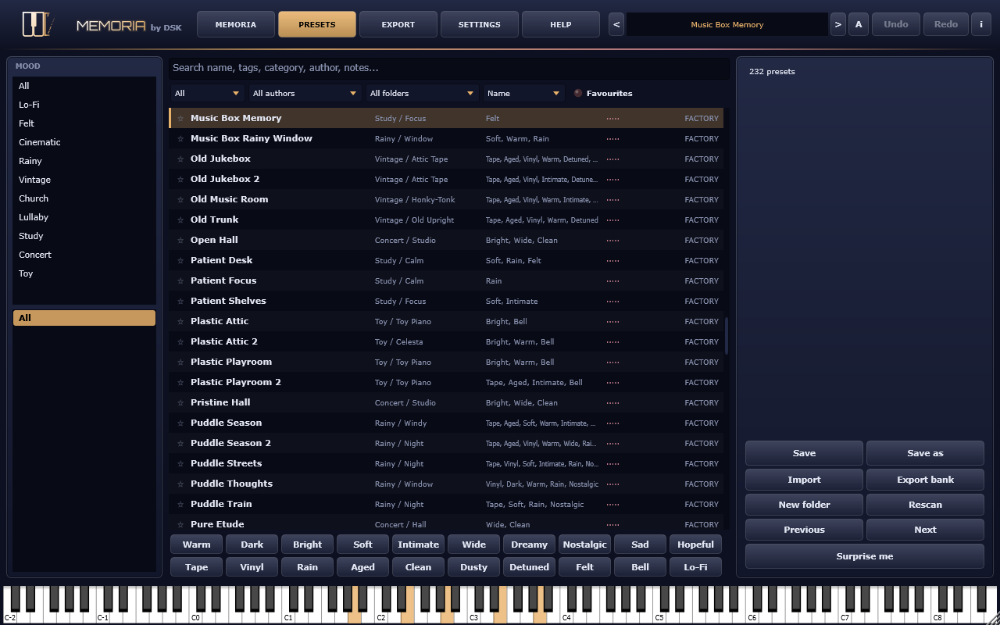
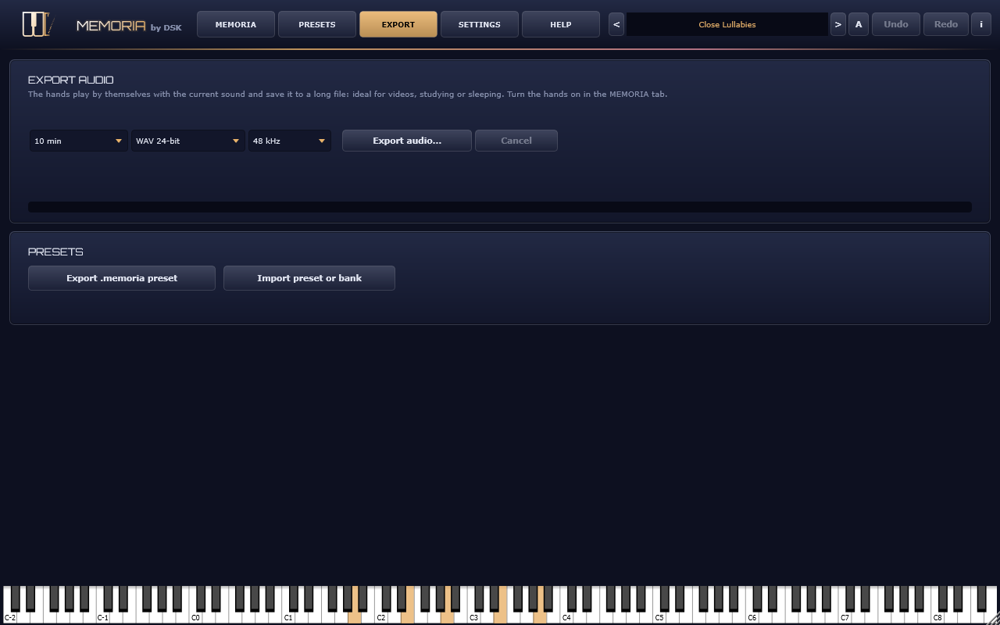

# Memoria by DSK

**An endless soundscape generator — a landscape of sound that never repeats.**

Free VST3 / AU / Standalone instrument by [DSK Music](https://www.dskmusic.com/memoria/) for ambient, film scoring and meditation.
**[Download](#download)** · [Product page](https://www.dskmusic.com/memoria/) · [Latest release](https://github.com/dskmusic/memoria-by-dsk/releases/latest)
Press **Play** and six layers — a mutating drone, a pad, a granular texture, shimmer, wind and bells — drift in and out on
their own, while harmony, light and space evolve slowly for minutes and hours without ever looping.


## Features

- **Living landscape engine:** seven self-playing layers - Drone, Pad, Texture, Shimmer, Wind, Bells and Bass. Each has Level,
  Presence (how much of the time it is there), Tone and Character; slow, never-repeating modulation decides when it appears.
- **Rich sound:** Spectral Mutation drone, PWM + saw analog pad with ensemble chorus and an 80s filter bloom, granular clouds tuned to
  octaves and fifths, pitch-shifted shimmer, a chord-following sub bass, melodic bell phrases, and a new hall reverb with pre-delay.
- **Harmony that moves:** 12 scales, any key, from open fifths to 7th and 9th chords, real chord progressions (I-IV-V-vi, cinematic i-VI-III-VII) with smooth voice-leading,
  or **chords locked to your DAW tempo** (every 1-16 bars).
- **Four big macros:** Evolution, Density, Light (night to midday) and Space (room to endless cathedral), plus a click-free **Freeze**.
- **Play / Stop** that also follows your DAW. Evolution comes from a **seed** and the timeline position: DAW bounces match playback,
  and the same seed always gives the same journey.
- **Six animated landscapes** that react to every layer: Valley, Starfield, Underwater, Neon, Ocean and Aurora - with
  **full-screen mode**, keyboard shortcuts and a text-free **relax mode**.
- **14 moods, 292 factory presets:** Cinematic, Ambient, Meditation, Dark, Sci-Fi, Ethereal, Oceanic, Nostalgia, Epic, Forest,
  Desert, Sleep and the melodic **Fairytale** and **Film Score**, with a composed **Melody** layer (music box, celesta or soft
  flute themes that repeat, answer and resolve over the chords). The generator renders several candidates, checks them and keeps the most alive one.
- **Long audio export:** 1 minute to 3 hours in WAV, FLAC or OGG. **Landscape video export:** an MP4 with the animated landscape and
  its sound, ready for YouTube (uses the free ffmpeg; Memoria finds it or helps you install it).
- **Sleep mode** and session timer, **432 Hz** tuning, **noise generator** (pink, brown, white, ocean waves, vinyl).
- **8 quick memories** with smooth 2-second crossfades, preset browser with tags and favourites, A/B, undo/redo, MIDI learn,
  and every preset change is click-free.
- Resizable and maximisable, **English / Español** interface (automatic or manual) with a friendly built-in **Help** page.

| | |
|---|---|
|  |  |
|  |  |
|  |  |
|  |  |
|  |  |

## Download

**Product page:** https://www.dskmusic.com/memoria/

| System | Recommended | Other formats |
|---|---|---|
| **Windows** 10/11 (64-bit) | [Installer (.exe)](https://github.com/dskmusic/memoria-by-dsk/releases/latest/download/Memoria-by-DSK-win-x64-setup.exe) | [VST3 (zip)](https://github.com/dskmusic/memoria-by-dsk/releases/latest/download/Memoria-by-DSK-win-x64-vst3.zip) · [Standalone (zip)](https://github.com/dskmusic/memoria-by-dsk/releases/latest/download/Memoria-by-DSK-win-x64-standalone.zip) |
| **macOS** 11+ (Universal: Apple Silicon + Intel) | [Installer (.pkg)](https://github.com/dskmusic/memoria-by-dsk/releases/latest/download/Memoria-by-DSK-macos-universal-installer.pkg) | [VST3](https://github.com/dskmusic/memoria-by-dsk/releases/latest/download/Memoria-by-DSK-macos-universal-vst3.zip) · [AU](https://github.com/dskmusic/memoria-by-dsk/releases/latest/download/Memoria-by-DSK-macos-universal-au.zip) · [Standalone](https://github.com/dskmusic/memoria-by-dsk/releases/latest/download/Memoria-by-DSK-macos-universal-standalone.zip) |
| **Linux** x86_64 | [VST3 (tar.gz)](https://github.com/dskmusic/memoria-by-dsk/releases/latest/download/Memoria-by-DSK-linux-x64-vst3.tar.gz) | [Standalone (tar.gz)](https://github.com/dskmusic/memoria-by-dsk/releases/latest/download/Memoria-by-DSK-linux-x64-standalone.tar.gz) |

All files and release notes: [latest release](https://github.com/dskmusic/memoria-by-dsk/releases/latest) · checksums: [SHA256SUMS.txt](https://github.com/dskmusic/memoria-by-dsk/releases/latest/download/SHA256SUMS.txt)

> The binaries are not code-signed. **Windows:** if SmartScreen appears, click *More info* → *Run anyway*.
> **macOS:** if the installer "can't be opened" or is "damaged", right-click it → *Open*, or run `xattr -dr com.apple.quarantine <file>` in Terminal.

### Install

- **Windows installer:** installs the VST3 to `C:\Program Files\Common Files\VST3` and the Standalone app.
- **macOS installer:** installs VST3, AU and the Standalone app. Rescan plugins in your DAW (Logic: AU Manager).
- **Manual:** copy `Memoria by DSK.vst3` to your VST3 folder (`~/.vst3` on Linux).

### Quick start

1. Load **Memoria** as an instrument and press **Play** (in the plugin, or your DAW's transport).
2. Turn **Evolution**, **Density**, **Light** and **Space**, pick a landscape, or press **GENERATE** on the Generator page.
3. Long render for videos or meditation: **Export** page → duration → WAV, FLAC or OGG.

Presets and settings are stored in `Documents/DSK Music/Memoria/`.

## Build from source

Requirements: CMake 3.22+, a C++20 compiler (Visual Studio 2022, Xcode 15 or GCC 11+), Ninja. JUCE 8 is downloaded automatically.

```bash
./build_local.sh Release            # macOS / Linux
build_local.bat Release             # Windows
```

The tool `MemoriaTool` runs the unit tests (`MemoriaTool test`), renders presets and regenerates the factory bank.

## License

GNU GPL v3 (see [LICENSE](LICENSE)). Built with [JUCE](https://juce.com) (GPLv3) and the VST3 SDK (MIT).
The Orbitron font is under the SIL Open Font License (see `licenses/`).
Parts of the engine (Spectral Mutation, FDN reverb, shimmer) come from [Genesix by DSK](https://github.com/dskmusic/genesix-by-dsk).

Spanish: [README.es.md](README.es.md)
