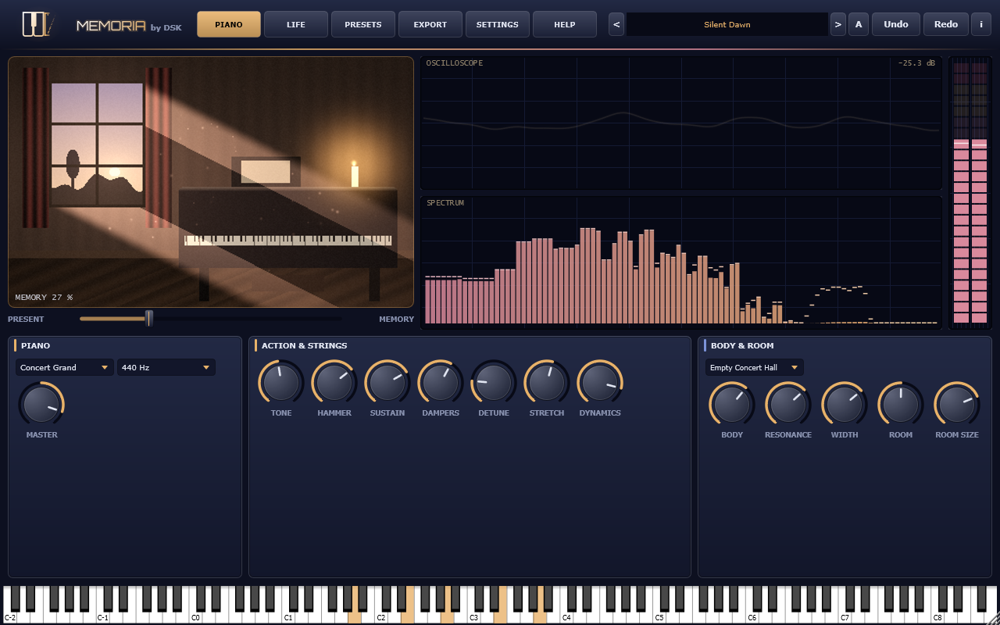

# Memoria by DSK

**A piano with a soul: a physically modelled piano wrapped in layers of memory.**

Free VST3 / AU / Standalone instrument by [DSK Music](https://www.dskmusic.com/memoria/) for lo-fi and chill beats, emotional piano,
film scoring, studying and relaxing.

**[Download](#download)** · [Product page](https://www.dskmusic.com/memoria/) · [Latest release](https://github.com/dskmusic/memoria-by-dsk/releases/latest)

No samples: every string, hammer and the soundboard are computed in real time, so the piano breathes with how you play.
On top of it live the things that turn a piano into a *memory*: the room, worn tape, vinyl dust, creaking wood, the rain on the
window. One slider, **Memory**, takes you from a crisp, present studio piano to a tape found in an attic.



## Features

- **Physically modelled piano (no sample library):** every partial is a decaying resonator with real string inharmonicity,
  2-3 detuned strings per note (beating), the piano's double decay, hammer felt that gets brighter with velocity,
  strike-position comb, dampers, soundboard modes and sympathetic resonance. The sustain pedal (CC64) is continuous: half pedal works.
- **Six instruments:** concert grand, upright, felt piano, honky-tonk, toy piano and celesta.
- **Memory macro** plus Warmth, Intimacy (close mic to far), Time (how aged the piano is) and Space.
- **Layers of life:** wooden sounds (bench, key action, pedal, dampers), tape (wow and flutter, saturation, dull highs, hiss, dropouts),
  vinyl (crackle, rumble, needle pop) and a distant world: rain, cafe, fireplace, dawn birds, audience. Five rooms: living room, church, studio, wooden cabin, empty concert hall.
- **Hands:** a generative pianist for people who do not play - arpeggios, chords with voice-leading, emotional phrases or everything at once,
  in 8 scales and any key, locked to your DAW tempo and transport (or an internal clock).
- **300 factory presets** in 10 categories: Lo-Fi, Felt, Cinematic, Rainy, Vintage, Church, Lullaby, Study, Concert and Toy. A rule-based generator
  validates and level-matches every preset; press *Surprise me* for a new one.
- **A room that ages with the sound:** a cinematic scene - window light, floating dust, rain on the glass, a candle - that turns sepia, grainy
  and scratched as you turn Memory up.
- **Long audio export:** the hands play for 1 minute to 3 hours to WAV, FLAC or OGG.
- Click-free preset changes, A/B, undo/redo, MIDI learn, preset browser with tags and favourites, resizable interface, **English / Español**
  (automatic or manual) and a built-in Help page.
- Deterministic: the offline bounce is identical to what you heard, at any host block size.

## Download

**Product page:** https://www.dskmusic.com/memoria/

| System | Recommended | Other formats |
|---|---|---|
| **Windows** 10/11 (64-bit) | [Installer (.exe)](https://github.com/dskmusic/memoria-by-dsk/releases/latest/download/Memoria-by-DSK-win-x64-setup.exe) | [VST3 (zip)](https://github.com/dskmusic/memoria-by-dsk/releases/latest/download/Memoria-by-DSK-win-x64-vst3.zip) · [Standalone (zip)](https://github.com/dskmusic/memoria-by-dsk/releases/latest/download/Memoria-by-DSK-win-x64-standalone.zip) |
| **macOS** 11+ (Universal: Apple Silicon + Intel) | [Installer (.pkg)](https://github.com/dskmusic/memoria-by-dsk/releases/latest/download/Memoria-by-DSK-macos-universal-installer.pkg) | [VST3](https://github.com/dskmusic/memoria-by-dsk/releases/latest/download/Memoria-by-DSK-macos-universal-vst3.zip) · [AU](https://github.com/dskmusic/memoria-by-dsk/releases/latest/download/Memoria-by-DSK-macos-universal-au.zip) · [Standalone](https://github.com/dskmusic/memoria-by-dsk/releases/latest/download/Memoria-by-DSK-macos-universal-standalone.zip) |
| **Linux** x86_64 | [VST3 (tar.gz)](https://github.com/dskmusic/memoria-by-dsk/releases/latest/download/Memoria-by-DSK-linux-x64-vst3.tar.gz) | [Standalone (tar.gz)](https://github.com/dskmusic/memoria-by-dsk/releases/latest/download/Memoria-by-DSK-linux-x64-standalone.tar.gz) |

All files and release notes: [latest release](https://github.com/dskmusic/memoria-by-dsk/releases/latest) · checksums: [SHA256SUMS.txt](https://github.com/dskmusic/memoria-by-dsk/releases/latest/download/SHA256SUMS.txt)

The binaries are not code-signed. **Windows:** SmartScreen may appear, click *More info* → *Run anyway*.
**macOS:** if the installer "can't be opened" or is "damaged", right-click it → *Open*, or run `xattr -dr com.apple.quarantine <file>` in Terminal.

### Install

- **Windows installer:** installs the VST3 in `C:\Program Files\Common Files\VST3` and the Standalone app.
  **macOS installer:** installs VST3, AU and the Standalone app. Rescan plugins in your DAW (Logic: AU Manager).
- **Manual:** copy `Memoria by DSK.vst3` to your VST3 folder (`~/.vst3` on Linux).

### Quick start

1. Load **Memoria** as an instrument and play it with a MIDI keyboard (pedal included), or press **Play** on the LIFE tab to let the **Hands** play.
2. Pick a preset (PRESETS tab) and slide **Memory** from *present* to *memory*.
3. Shape the piano (Tone, Hammer, Sustain, Dampers, Detune...) and the room, or press **Surprise me**.

Presets and settings are stored in `Documents/DSK Music/Memoria/`.

## Build from source

Requirements: CMake 3.22+, a C++20 compiler (Visual Studio 2022, Xcode 15 or GCC 11+), Ninja. JUCE 8 is downloaded automatically.

```bash
./build_local.sh Release            # macOS / Linux
build_local.bat Release             # Windows
```

The `MemoriaTool` command line tool (built alongside) runs the tests (`test`), generates the factory bank (`factory`),
renders listening material (`piano`, `hands`) and the screenshots, demo video and trailer (`screenshot`, `video`, `trailer`).

## License

GPLv3 - see [LICENSE](LICENSE) and [licenses/](licenses/). Built with [JUCE](https://juce.com) and the Orbitron font (OFL).
